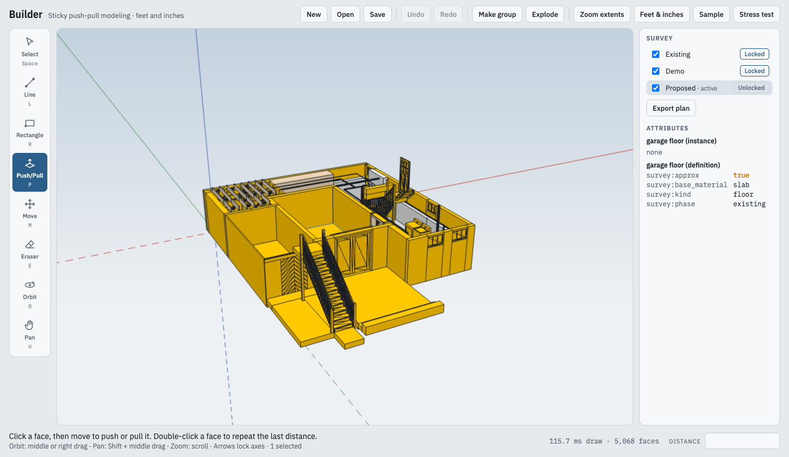
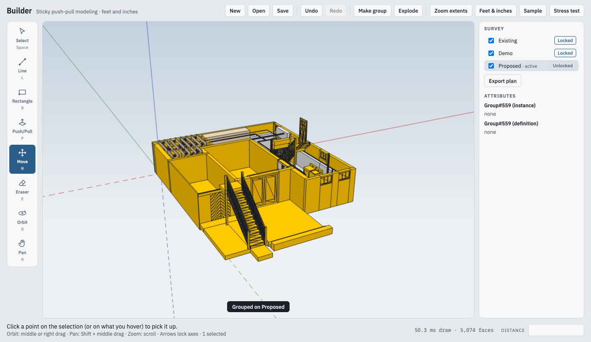

# End-to-end walkthrough

The whole loop on a real house, run 2026-10-27 on a scratch copy of 20SPierson (its `survey.yaml` with `output_stem: basement`, its spec with the `materials:` section): build, validate, open in Builder, lock, tags, `~` colour, attributes, draw, export, build the plan. The browser part was driven headlessly by `survey/tests/walkthrough.mjs`; the same steps by hand are in brackets.

## 1. Build and validate

```
$ uv run --project survey survey build --project ../20SPierson
basement.sh3d: 31 walls, 121 pieces, 9 rooms
133 elements built; 5 CONFLICTS, 0 MISSING, 122 placeholder values. See ../20SPierson/model/out/report.md

$ cargo run -p builder-kernel --example validate -- ../20SPierson/model/out/basement.builder
559 definitions, 558 instances, 3 tags: ok
```

559 definitions: the root, 133 element groups and 425 part groups. 88 of the elements carry `survey:approx: true`.

## 2. Open in Builder

```
$ make start
Builder is running at http://localhost:5173/ (pid 64135, log .run/dev.log)
```

[File > Open, pick `basement.builder`.] The toast says "Survey model: Existing and Demo are locked, new groups go on Proposed", and the survey panel appears:

```
survey panel {"hidden":false,"tags":["ExistingLocked","DemoLocked","ProposedUnlocked"],"toast":"Opened basement.builder"}
model tags [{"id":0,"locked":true,"name":"Existing","visible":true},{"id":1,"locked":true,"name":"Demo","visible":true},{"id":2,"locked":false,"name":"Proposed","visible":true}]
```

Elements placed from a `~` value are drawn in the placeholder material (orange), the others in their material colours.

## 3. Select an approximate element

[Select tool, click the garage floor.] The attribute view lists the instance (no attributes) and the definition's `survey` namespace, with `approx` in orange:

```
select approx {"id":10,"name":"garage floor","attrs":{"survey":{"approx":true,"base_material":"slab","kind":"floor","phase":"existing"}}}
attribute view "garage floor (instance)\n\nnone\n\ngarage floor (definition)\nsurvey:approx\ntrue\nsurvey:base_material\nslab\nsurvey:kind\nfloor\nsurvey:phase\nexisting"
```



## 4. Locked

[Move tool, click the selected floor.] The kernel refuses the write and the message names the tag:

```
move locked "Locked: Existing"
```

Push/Pull and the Eraser do not offer locked faces at all; Select still picks them, so their attributes can be read.

## 5. Hide and show a tag

[Untick Existing in the tag strip.] The flags are a journaled write (Undo brings it back):

```
hide existing {"tags":[{"id":0,"locked":true,"name":"Existing","visible":false}, ...],"toast":"Hide Existing"}
show existing {"id":0,"locked":true,"name":"Existing","visible":true}
```

## 6. Draw on Proposed

[Rectangle on the ground at 24' east, 30' south, `2'6", 1'9"`; Push/Pull `2'10"`; select the six faces; G.] The group lands on the active tag:

```
draw and group {"group":{"kind":"instance","id":558},"props":{"locked":false,"material":null,"name":"","tag":2},"toast":"Grouped on Proposed"}
```



## 7. Export the plan

[Export plan in the survey panel, name `vanity`; the browser downloads `vanity.yaml`.]

```
export plan {"yaml":"description: drawn in Builder 2026-10-27, plan vanity\nadd:\n  objects:\n    proposed_1: {type: box, at: [24', 30', 0\"], size: [2'6\", 1'9\", 2'10\"], material: proposed, phase: proposed}\n","skipped":[]}
```

## 8. Build the plan

```
$ cp ~/Downloads/vanity.yaml ../20SPierson/model/plans/
$ uv run --project survey survey build --project ../20SPierson --plan vanity
basement.sh3d: 31 walls, 122 pieces, 9 rooms
134 elements built; 5 CONFLICTS, 0 MISSING, 122 placeholder values. See ../20SPierson/model/out/plans/vanity/report.md

$ cargo run -p builder-kernel --example validate -- ../20SPierson/model/out/plans/vanity/basement.builder
561 definitions, 560 instances, 3 tags: ok
```

The box is where it was drawn. From `out/plans/vanity/mesh.json`, element `proposed_1`: phase `proposed`, material `proposed`, kind `object`, x 288–318, y −381–−360, z 0–34 (inches; 24' = 288, 30' south = y −360, 1'9" = 21 deep). Opening that `basement.builder` shows the vanity on Proposed next to the locked existing conditions.

## 9. Phone capture: waiting on Patrick

Not run here (no phone on this Mac). The server, the entry format and transcription are tested in `survey/tests/test_capture.py`, and a spoken m4a produced with macOS `say` transcribed to "Return pipe is 32 and a half inches to the top at the West Wall" with the `tiny.en` model. The remaining step is Patrick's, on his return: install the mkcert root CA on the iPhone ([capture.md](capture.md)), `survey capture` with the certificate, save a photo plus a voice note from the house, run `survey entries --uncited`, put the number in the spec with `source:`, rebuild, and see the change in Builder.
